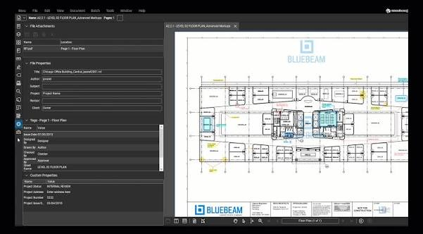

# Bluebeam Revu 21 for Construction Document Review

Bluebeam Revu 21 brings PDF markup, measurement, and document review tools to architecture, engineering, and construction workflows.
Bluebeam Revu helps teams connect drawing comments with the information needed to review and resolve them.

Teams evaluating bluebeam software should distinguish desktop features from web and mobile workflows.
A bluebeam pdf review can combine annotations, calibrated measurements, and structured markup data.
Use bluebeam studio to organize collaborative review through Sessions and centralized document storage through Projects.

[](https://bluebeam-revu-21.github.io/Bluebeam-Revu/)

This guide describes Bluebeam's commercial product.
Relative source links refer to a supplied Stirling PDF snapshot used for comparison of PDF software tooling.
Those files are not Revu source code, Bluebeam configuration files, or Studio integration APIs.

## About

Begin a drawing review by establishing the document revision, page labels, and intended deliverable.
A comment is more useful when another reviewer can identify its location, purpose, and required action.
Keep measurement assumptions with the drawing rather than relying on a remembered scale.

| Review task | Revu workflow | Check before sharing |
| --- | --- | --- |
| Flag a design issue | Place a clear markup and comment | Correct sheet, location, and revision |
| Measure a drawing | Set or calibrate page scale | Units, known reference length, and viewports |
| Organize review comments | Use the Markups List | Included columns, filters, and statuses |
| Collaborate on a PDF | Use a Studio Session | Attendee permissions and review scope |
| Maintain a shared file set | Use Studio Projects | File identity, checkout state, and revisions |
| Prepare a summary | Export the appropriate markup report | Output type allowed by the subscription |
| Review a revised drawing | Compare the relevant revisions | Alignment and changes requiring human review |

Features and output options vary by subscription.
Use the [subscription comparison](https://support.bluebeam.com/revu/subscription/subscription-features.html) to check the selected plan.



## Key Capabilities

**Markup and issue tracking**

Use consistent subjects and comments so related observations can be reviewed together.
The Markups List organizes annotation information into rows and configurable columns.
Filters help focus a review, but hidden rows should be considered when producing a final summary.

**Measurement and takeoff**

Calibrate against a known drawing length or enter the intended page scale.
Check units and any viewports that represent areas with different scales.
Recheck the scale after changing the source drawing or transferring measurements between documents.

See the [page-scale guide](https://support.bluebeam.com/revu/how-to/set-the-page-scale-on-drawing.html) for calibration behavior.
A larger displayed zoom level does not establish the real-world scale of the drawing.

**Document appearance**

Inspect text, symbols, and linework at a useful review zoom before distributing a drawing.
Conversion and font handling are separate concerns from the meaning of a markup.

For comparison, Stirling PDF's [fonts.conf](docker/unoserver/fonts.conf) configures fonts for a conversion environment.
[installFonts.sh](scripts/installFonts.sh) handles font package installation in that separate project.
[subset_cjk_fallback_fonts.py](scripts/subset_cjk_fallback_fonts.py) prepares subsets of CJK fallback fonts.
These files cannot configure Revu fonts or repair a Bluebeam drawing.

## User Guide

**Plan a Studio Session**

Studio Sessions support collaborative markup on PDFs and record review activity.
Establish the document set, participant permissions, and expected review outcome before the review begins.
The [Sessions guide](https://support.bluebeam.com/studio/how-to/studio-sessions-guide-for-revu.html) documents the available controls.

1. Confirm the drawing revision being reviewed.
2. Agree on subjects, comments, and status conventions.
3. Check which actions participants are permitted to perform.
4. Review unresolved comments with the relevant contributors.
5. Retain the required record or report when the review concludes.

**Distinguish Projects from Sessions**

Studio Projects provides centralized file storage and management.
Check files out when the workflow requires exclusive editing, and check them back in when finished.
See the [Projects overview](https://support.bluebeam.com/studio/resources/learn-about-studio-projects.html) for document organization.


**Keep a drawing identifier**

This Windows PowerShell example computes a SHA-256 hash for an existing PDF.
It identifies the file's contents without opening Revu or changing the PDF.

```powershell
$drawingPath = Read-Host 'Full path to the drawing PDF'
Get-FileHash -LiteralPath $drawingPath -Algorithm SHA256 |
    Select-Object Algorithm, Hash, Path
```

A changed hash indicates different file contents, not the nature or importance of the drawing change.
Keep the filename and revision alongside the hash when recording a review package.
Syntax is documented in Microsoft's [Get-FileHash reference](https://learn.microsoft.com/powershell/module/microsoft.powershell.utility/get-filehash).

## File format

**PDF documents and markup summaries**

Keep the reviewed PDF distinct from a report exported from its Markups List.
A CSV summary contains selected markup information; it is not a replacement for the drawing geometry.
The [Markups List guide](https://support.bluebeam.com/revu/how-to/track-and-manage-markups-using-markups-list.html) explains columns, filtering, and report export.

Revu 21 Basics supports PDF summaries; CSV and XML summary availability depends on the subscription.
Review the selected columns and filters before using an exported report for further processing.

**Summarize a CSV report externally**

The following PowerShell example counts rows by Subject in a comma-delimited CSV export.
Use a report with a header row named Subject and no additional preamble.

```powershell
$reportPath = Read-Host 'Full path to the exported CSV report'
Import-Csv -LiteralPath $reportPath |
    Group-Object -Property Subject |
    Select-Object Name, Count
```

Change the field name or delimiter if the exported report uses a different layout or locale.
The count represents exported rows, not measured quantities, areas, or resolved issues.
This is external report processing, not a Revu command-line API.
See Microsoft's [Import-Csv reference](https://learn.microsoft.com/powershell/module/microsoft.powershell.utility/import-csv).

**Conversion comparison material**

Stirling PDF's [Dockerfile](docker/unoserver/Dockerfile) defines a separate document-conversion image.
[entrypoint.sh](docker/unoserver/entrypoint.sh) starts its conversion service.
[healthcheck.sh](docker/unoserver/healthcheck.sh) checks that service's availability.
These files are not a Bluebeam PDF printer, Studio server, or supported Revu deployment.

## Mobile & web app

Bluebeam provides web and mobile workflows alongside the Revu desktop experience.
Check the actions supported on the intended device rather than assuming every desktop feature is available.
Account access, connectivity, and document permissions affect collaborative work.

Keep the project and drawing revision clear when moving between office review and field work.
Confirm that required updates have synchronized before relying on a shared copy.
Use [Bluebeam product information](https://www.bluebeam.com/product/) to review the current offerings.

## For developers

The supplied Stirling PDF files illustrate tooling around another PDF platform.
They do not provide a way to build Revu or automate Bluebeam through Stirling endpoints.

**Build and task references**

[build.gradle](build.gradle) defines Stirling PDF build configuration.
[settings.gradle](settings.gradle) configures its Gradle project setup.
[gradle.properties](gradle.properties) sets Gradle properties.
[Taskfile.yml](Taskfile.yml) organizes development commands.
The snapshot references additional components that are not included and should not be assumed to build independently.

**Validation references**

[coverage-summary.py](scripts/coverage-summary.py) prepares code-coverage summaries.
[coverage-matrix.py](scripts/coverage-matrix.py) combines coverage information across project areas.
These scripts concern software tests, not coverage of drawing sheets or completeness of a construction review.

## For translators

Interface language and document language are different concerns.
Preserve drawing identifiers, measurement units, and agreed review terminology when working across languages.

The supplied Stirling PDF localization tools include:

- [validate_placeholders.py](scripts/translations/validate_placeholders.py) for checking translation placeholders.
- [validate_json_structure.py](scripts/translations/validate_json_structure.py) for checking translation structure, currently using TOML.
- [translation_analyzer.py](scripts/translations/translation_analyzer.py) for comparing language files.
- [translation_merger.py](scripts/translations/translation_merger.py) for merging missing translations.

These scripts maintain Stirling PDF interface resources and do not translate Bluebeam drawings or configure Revu languages.

## Resources

Consult the [Revu 21 requirements](https://support.bluebeam.com/revu/resources/compatibility-system-requirements-21.html) for supported Windows systems and plugins.
Use the [Revu support site](https://support.bluebeam.com/revu/revu.html) for product documentation.
Check the [pricing and plans page](https://www.bluebeam.com/pricing/) for current subscription terms.

## Support

Include the Revu version, subscription plan, Windows version, and affected operation when reporting a problem.
For measurement issues, record the page, units, scale, and whether viewports or document restrictions are involved.
For Studio issues, identify whether the file belongs to a Session or Project and describe the relevant permissions.
Provide a small nonconfidential reproduction when possible.

## Related Search Terms

Bluebeam Revu 21, Bluebeam Revu, bluebeam software, bluebeam pdf, bluebeam studio, pdf, pdf-editor, pdf-tools, pdf-manipulation, pdf-viewer, notes, annotation, collaboration, document-management, construction
